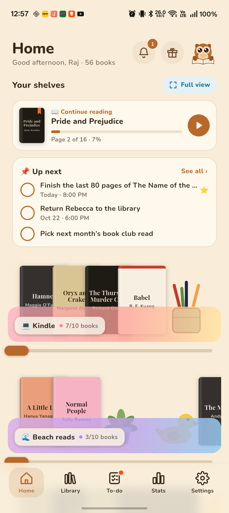
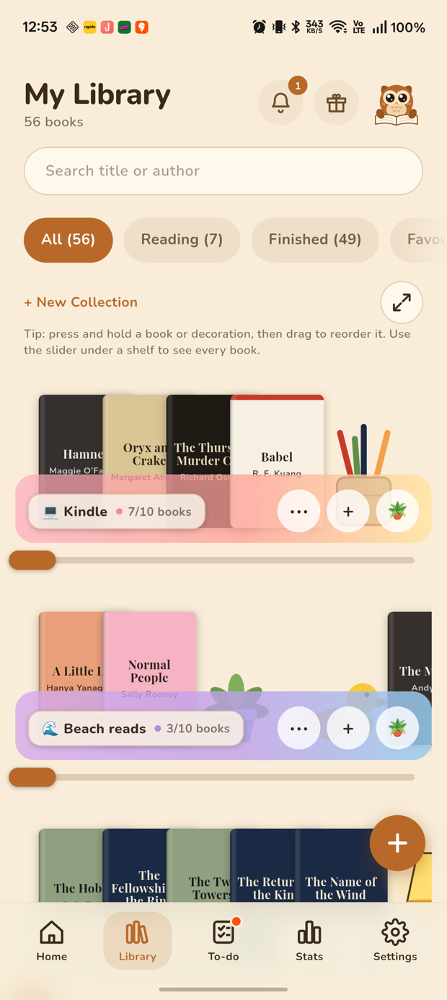
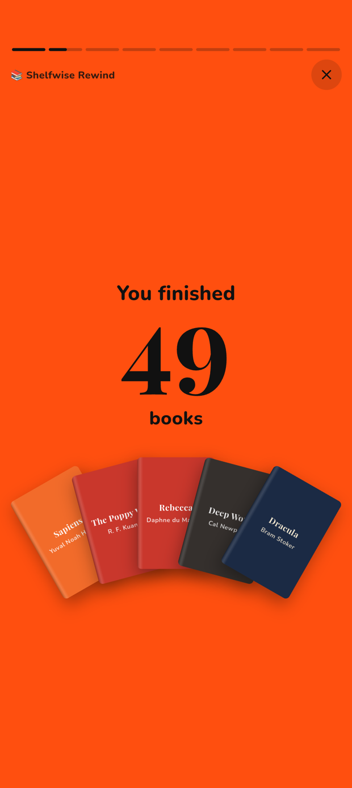

# Shelfwise 🦉📚

A cozy bookshelf and reading to-do app for Android, built with Flutter.

**Download:** grab the latest APK from the [releases page](https://github.com/Mr-Who-Root/shelfwise/releases/latest), or visit the [website](https://mr-who-root.github.io/shelfwise/).

<p align="center">
  
  
  
  
  
</p>

## Features

- **Cozy shelves.** Overlapping book spines on pastel glass shelves. Press a book to lift it, long-press to drag it into a new spot, and use the slider to see every book. Each shelf holds 10 spots, with a sub shelf for 10 more.
- **Decorations you can play with.** Lamps switch on, candles light, the owl flies off and comes back, clocks ring and ducks squeak. All sounds are synthesised in the app.
- **Read your own PDFs.** Attach a PDF when you add a book. At normal size, pages curl over like paper when you drag a corner. Pinch or double-tap to zoom in place; while zoomed, swipe past the edge for the next page. Shelfwise remembers where you stopped.
- **Reading to-do list.** Bento-style cards with due dates, reminders, stars, hashtags and a linked book.
- **Stats & Rewind.** See this month, this year or all time. Rewind plays a story-style recap you can share or save as an image, and your stats can be shared as a card.
- **Make it yours.** Light, dark or follow your phone; five accent colours; Nunito, Inter or Lora; three text sizes.
- **Rewards.** Milestones unlock badges, with confetti.
- **100% local.** No account, no ads, works offline. Use **Settings → Share backup** to save a backup file, and **Settings → Import backup** on a new phone. Backups hold everything except PDF copies.

## Build

```bash
flutter pub get
flutter build apk --release --target-platform android-arm,android-arm64
```

Release builds are signed with the key referenced by `android/key.properties`, which is git-ignored. Without that file, the build falls back to the debug key.

## Workflow

Work happens on `dev`. Once a build has been tested on a device, `dev` is merged into `main`. Each release attaches `shelfwise.apk` to a GitHub release, and the website in `docs/` (GitHub Pages) links to the latest one.

## Credits

The design is based on the "Readers" HTML mockup. The fonts (Nunito, Inter, Lora, Playfair Display and Caveat) are from Google Fonts under the SIL Open Font License.
